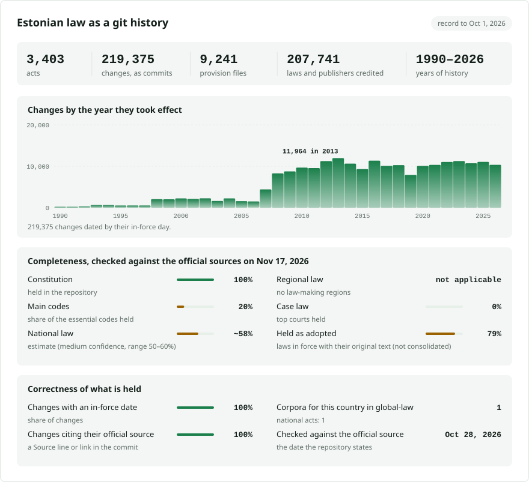

# Estonia: law history in git

**English** · **[Või lugege eesti keeles](README.md)**

<picture>
<source media="(prefers-color-scheme: dark)" srcset="data/effort-dark.svg">

</picture>

The law of Estonia as a git history: one file per section (§), one commit per amending act on the day its changes took effect, and that act as the commit's author. `git blame` names the act behind every line; `git log` lists every change to a section; picking a date gives the text in force that day.

Part of [lexifina/global-law](https://github.com/lexifina/global-law), one git history for every country's law: this is Estonia's national law, which global-law reads at `estonia/national/acts/`.

**What is in it now:** three acts from Riigi Teataja, the Constitution (Eesti Vabariigi põhiseadus), the Riigikogu Election Act (Riigikogu valimise seadus) and the Personal Data Protection Act (Isikuandmete kaitse seadus), with their 42 consolidated versions since 2002 and the Constitution's 1992 text, in 58 commits: the three first texts, 44 changes by 40 amending acts, and 11 labelled changes no amending act explains. [`muutmisaktid.csv`](muutmisaktid.csv) lists every amending act with its dates; each act's README ([`ps/README.md`](ps/README.md)) lists its sections.

Each act is a folder named by its abbreviation (`ps`, `rkvs`, `iks`), with one file per section after Riigi Teataja's element id (`ps/para-156.md` is § 156 of the Constitution, `rkvs/para-048b4.md` is § 48⁴ of the Election Act); `preambul.md` is the preamble and `sisukord.md` the chapter headings.

The text is in Estonian, as Riigi Teataja publishes it; only the Estonian text has legal force. The English and Russian translations are not part of this record.

## Questions as git commands

| Question | Command |
| --- | --- |
| Every change to § 156 of the Constitution | `git log -p --word-diff -- ps/para-156.md` |
| Which act wrote each line of § 156? | `git blame ps/para-156.md` |
| Every version of the Constitution, with the day each took effect | `git log --format="%h %(trailers:key=In-force,valueonly,separator=) %an" -- ps ":!ps/README.md"` |
| § 156 as in force on 1 January 2010 | `python tools/seisuga.py 2010-01-01 ps 156` |

**Outside git**, we also host this record publicly, for free:

- **[Ask Claude about Estonian law](https://global-law.lexifina.com/v1/try_claude?country=estonia)**: opens Claude with a first question ready.
- **[Ask ChatGPT](https://global-law.lexifina.com/v1/try_chatgpt?country=estonia)**: the same question in ChatGPT.
- **[Call the API in your browser](https://global-law.lexifina.com/v1/search_law?query=isikuandmed&jurisdictions=estonia)**: a search of Estonian law for "isikuandmed" (personal data), returned as JSON. See the [documentation here](https://lexifina.com/api/global-law).

Both assistants read the record through the free Global law connector (MCP, `https://global-law.lexifina.com/mcp`); the first time, the chat gives you the link that adds it. Ask in Estonian or in English.

**Host it yourself easily.** All it takes is git and Python, and the tools run on your machine:

```sh
git clone --depth 1 https://github.com/lexifina/global-law && cd global-law
python3 tools/countries.py add estonia/national/acts
python3 tools/law.py show 2026-01-01 estonia/national/acts/ps/para-156.md
```

Opened in Claude Code, Cursor, VS Code or Codex, the clone also starts a local MCP server with the same tools ([MCP.md](https://github.com/lexifina/global-law/blob/main/MCP.md)).

## Dates

Each commit is dated at noon, Europe/Tallinn, on the day the change took effect, and carries it in its `In-force:` trailer, beside `Adopted:`, `Proclaimed:` and `Published:`:

- the day is the one in the amendment mark (muutmismärge) Riigi Teataja prints under each changed provision, which is the day the consolidated version holding the change became valid;
- the first commit of each act is its original text on the day the act came into force (the Constitution's on 1992-07-03, ten years before Riigi Teataja's first consolidated version);
- two changes take effect inside a version (Constitution § 156 on 2005-10-17, Election Act § 7 on 2014-07-01) and are committed on the day their mark gives.

Each change is credited to the amending act Riigi Teataja's marks name, by its reference (`RT I, 03.01.2020, 2`). Changes no mark explains (spacing, characters corrupted in Riigi Teataja's own files for three 2004–2006 versions, editorial changes) are committed by `Riigi Teataja` and labelled.

## How it is checked

- `tools/check_repo.py` reads every act back from git on every day its text changed and compares every file with that version's text in Riigi Teataja's XML: 0 mismatches in 4,670 files.
- The XML reading of each version equals Riigi Teataja's own plain text of it (`/txt`), apart from whitespace and its bracketed amendment notes: all 42 versions match.
- Every source file's sha256 is checked against `data/versioonid.json`, and two builds from the same data give the same hashes for every commit and tag. Details in [`REPRODUCE.md`](REPRODUCE.md).

## What it does not show

- **The rest of Estonian law.** Only these three acts are here: no other laws (such as the Employment Contracts Act), regulations, local acts or case law.
- **Versions before 2002**, when Riigi Teataja's electronic consolidated texts begin.
- **Annexes, signatures and the publisher's notes** (the Constitution's closing "Õiend", error-correction notes).
- **Provisions that came into force later than their act**, unless Riigi Teataja published a separate version for them.

## Sources

| Source | Kind | Past versions | Notes |
| --- | --- | --- | --- |
| [Riigi Teataja](https://www.riigiteataja.ee) (Justiits- ja Digiministeerium) | Official online publication of the Republic of Estonia | yes, every consolidated version since 2002 | Read through its public API: each version's text, validity dates, amendment marks and amending acts |

## Licence

See [`LICENSE`](LICENSE). The legal text is not protected by copyright (Autoriõiguse seadus § 5 p 3); the history, commit messages, tables and tools are CC0 1.0.

No AI model wrote or changed legal text, and none runs when the history is built; the scripts were written by an AI model (see [`REPRODUCE.md`](REPRODUCE.md)).

## More

From [lexifina/global-law](https://github.com/lexifina/global-law):

- [FEATURES.md](https://github.com/lexifina/global-law/blob/main/FEATURES.md): every feature, and what every corpus must support (`git blame`, `law.py`, the MCP tools)
- [FAQ.md](https://github.com/lexifina/global-law/blob/main/FAQ.md): questions and answers · [CONTRIBUTING.md](https://github.com/lexifina/global-law/blob/main/CONTRIBUTING.md): proposing changes · [MCP.md](https://github.com/lexifina/global-law/blob/main/MCP.md): the MCP server · [REPRODUCE.md](https://github.com/lexifina/global-law/blob/main/REPRODUCE.md): how it was built · [CHANGELOG.md](https://github.com/lexifina/global-law/blob/main/CHANGELOG.md)
- [FRESHNESS.md](https://github.com/lexifina/global-law/blob/main/FRESHNESS.md): how current each corpus is · [Monitoring](https://github.com/lexifina/global-law/tree/main/monitoring): whether updates are running · [WATCHING.md](https://github.com/lexifina/global-law/blob/main/WATCHING.md): how each official source is watched for changes
- [performance/](https://github.com/lexifina/global-law/tree/main/performance): how fast the tools are, measured
- [visualisations/](https://github.com/lexifina/global-law/tree/main/visualisations): charts and bridges across the world's law
- [Vulnerabilities](https://github.com/lexifina/global-law/tree/main/vulnerabilities): mistakes in legislation as published
