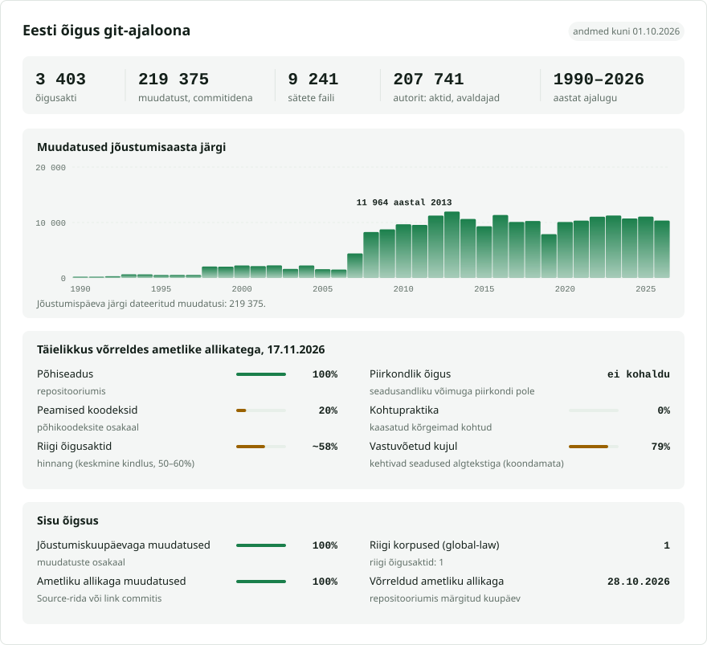

# Eesti: õiguse ajalugu git'is

**Eesti keel** · **[Or read it in English](README.en.md)**

<picture>
<source media="(prefers-color-scheme: dark)" srcset="data/et/effort-dark.svg">

</picture>

Eesti õigus git-ajaloona: üks fail paragrahvi kohta, üks commit iga muutmisakti kohta päeval, mil selle muudatused jõustusid, ja commit'i autor on see akt. `git blame` nimetab iga rea taga oleva akti; `git log` loetleb paragrahvi kõik muudatused; kuupäeva valides saab teksti, mis sel päeval kehtis.

Osa repositooriumist [lexifina/global-law](https://github.com/lexifina/global-law), mis on kõigi riikide õiguse ühine git-ajalugu: siin on Eesti riigisisene õigus, mida global-law loeb kaustast `estonia/national/acts/`.

**Mis siin praegu on:** põhiseadus ja veel kaks Riigi Teatajast pärit akti koos 42 terviktekstiredaktsiooniga alates 2002. aastast; Riigikogu avaandmetest üle 300 seaduse Riigikogus vastuvõetud kujul, nende hulgas peamised seadustikud (vastuvõetud tekst, mitte terviktekst), kaustas [`riigikogu/seadused/`](riigikogu/seadused/), metaandmete kirje iga Riigikogu eelnõu kohta alates 1992. aastast (9041) kaustas [`riigikogu/eelnoud/`](riigikogu/eelnoud/), 22 666 täiskogu hääletust, 4618 istungi stenogrammi, umbes 42 000 Riigikogu toimikut ja umbes 105 000 ametlikku dokumenti (komisjonide päevakorrad, ELi dokumendid, protokollid, otsused, arupärimised ja kirjalikud küsimused koos vastustega); Tartu Linnavolikogu 5349 õigusakti alates 1993. aastast; ning umbes 4000 ELi õiguse ülevõtmise kirjet. [`muutmisaktid.csv`](muutmisaktid.csv) loetleb kõik muutmisaktid; iga akti README ([`ps/README.md`](ps/README.md)) loetleb selle paragrahvid.

Iga akt on lühendi järgi nimetatud kaust (`ps`, `rkvs`, `iks`), milles on üks fail paragrahvi kohta Riigi Teataja elemendi id järgi (`ps/para-156.md` on põhiseaduse § 156, `rkvs/para-048b4.md` on Riigikogu valimise seaduse § 48⁴); `preambul.md` on preambul ja `sisukord.md` peatükkide pealkirjad.

Tekst on eesti keeles, nii nagu Riigi Teataja selle avaldab; õigusjõud on ainult eestikeelsel tekstil. Inglis- ja venekeelsed tõlked ei ole selle repositooriumi osa.

## Küsimused git-käskudena

| Küsimus | Käsk |
| --- | --- |
| Põhiseaduse § 156 kõik muudatused | `git log -p --word-diff -- ps/para-156.md` |
| Milline akt kirjutas § 156 iga rea? | `git blame ps/para-156.md` |
| Põhiseaduse kõik redaktsioonid koos jõustumispäevaga | `git log --format="%h %(trailers:key=In-force,valueonly,separator=) %an" -- ps ":!ps/README.md"` |
| § 156 sellisena, nagu see kehtis 1. jaanuaril 2010 | `python tools/seisuga.py 2010-01-01 ps 156` |

**Väljaspool git'i** pakume seda repositooriumi ka avalikult ja tasuta:

- **[Küsige Claude'ilt Eesti õiguse kohta](https://global-law.lexifina.com/v1/try_claude?country=estonia)**: avab Claude'i valmis esimese küsimusega.
- **[Küsige ChatGPT-lt](https://global-law.lexifina.com/v1/try_chatgpt?country=estonia)**: sama küsimus ChatGPT-s.
- **[Otsige Eesti õigusest meie veebilehel](https://lexifina.com/law?country=estonia&q=isikuandmed)**: „isikuandmed“ otsing, iga sätte teksti ja selle redaktsioonidega, ilma kontota.
- **[REST API arendajatele](https://global-law.lexifina.com/v1/search_law?query=isikuandmed&jurisdiction=estonia)**: sama otsing JSON-vormingus, ilma võtmeta. Dokumentatsioon on [siin](https://lexifina.com/api/global-law).

Mõlemad assistendid loevad andmeid tasuta Global law konnektori kaudu (MCP, `https://global-law.lexifina.com/mcp`); esimesel korral annab vestlus lingi, millega konnektor lisada. Küsige eesti või inglise keeles.

**Käivitage see hõlpsalt ise.** Piisab git'ist ja Pythonist ning tööriistad töötavad teie arvutis:

```sh
git clone --depth 1 https://github.com/lexifina/global-law && cd global-law
python3 tools/countries.py add estonia/national/acts
python3 tools/law.py show 2026-01-01 estonia/national/acts/ps/para-156.md
```

Kui klooni avada Claude Code'is, Cursoris, VS Code'is või Codexis, käivitab see ka samade tööriistadega kohaliku MCP-serveri ([MCP.md](https://github.com/lexifina/global-law/blob/main/MCP.md)).

## Kuupäevad

Iga commit on dateeritud keskpäevaga Tallinna aja järgi (Europe/Tallinn) päeval, mil muudatus jõustus, ja see päev on ka tema `In-force:` trailer'is, `Adopted:`, `Proclaimed:` ja `Published:` kõrval:

- päev on see, mis on muutmismärkes, mille Riigi Teataja trükib iga muudetud sätte alla, ehk päev, mil muudatust sisaldav terviktekst hakkas kehtima;
- iga akti esimene commit on akti algtekst päeval, mil akt jõustus (põhiseaduse puhul 1992-07-03, kümme aastat enne Riigi Teataja esimest terviktekstiredaktsiooni);
- kaks muudatust jõustuvad redaktsiooni sees (põhiseaduse § 156 2005-10-17, Riigikogu valimise seaduse § 7 2014-07-01) ja on commit'itud päeval, mille nende märge annab.

Iga muudatus omistatakse muutmisaktile, mille Riigi Teataja märked nimetavad, selle viite järgi (`RT I, 03.01.2020, 2`). Muudatused, mida ükski märge ei selgita (tühikud, Riigi Teataja enda failides rikutud märgid kolmes 2004–2006 redaktsioonis, toimetuslikud muudatused), on commit'itud nimega `Riigi Teataja` ja märgistatud.

## Kuidas seda kontrollitakse

- `tools/check_repo.py` loeb iga akti git'ist tagasi iga päeva seisuga, mil selle tekst muutus, ja võrdleb iga faili selle redaktsiooni tekstiga Riigi Teataja XML-is: 4 670 failis 0 erinevust.
- Iga redaktsiooni XML-ist loetud tekst ühtib Riigi Teataja enda lihttekstiga samast redaktsioonist (`/txt`), välja arvatud tühimärgid ja nurksulgudes muudatusmärkused: kõik 42 redaktsiooni ühtivad.
- Iga lähtefaili sha256-räsi kontrollitakse faili `data/versioonid.json` alusel ning kaks ehitust samadest andmetest annavad igale commit'ile ja sildile samad räsid. Üksikasjad on failis [`REPRODUCE.md`](REPRODUCE.md).
- [vulnerabilities/](vulnerabilities/): võimalikud sõnastusvead selles õiguses, mille leiavad global-law detektorid ja mida kontrollitakse käsitsi. Pole veel käivitatud.

## Mida see ei näita

- **Terviktekste peale nende kolme akti.** Riigi Teataja, kes neid avaldab, ei luba automaatset juurdepääsu, seega on teised seadused siin ainult Riigikogus vastuvõetud kujul, hilisemaid muudatusi sisse viimata. Seadused, millel puudub kontrollitav vastuvõetud teksti fail (enamik aastatest 1992–1995 ja mõned teised), on kõrvale jäetud. Määrusi, kohalikke õigusakte ega kohtupraktikat siin ei ole.
- **Redaktsioone enne 2002. aastat**, mil algavad Riigi Teataja elektroonilised terviktekstid.
- **Lisasid, allkirju ja väljaandja märkusi** (põhiseaduse lõpus olev „Õiend“, veaparanduse märkused).
- **Sätteid, mis jõustusid hiljem kui akt ise**, välja arvatud juhul, kui Riigi Teataja avaldas nende jaoks eraldi redaktsiooni.

## Allikad

| Allikas | Liik | Varasemad redaktsioonid | Märkused |
| --- | --- | --- | --- |
| [Riigi Teataja](https://www.riigiteataja.ee) (Justiits- ja Digiministeerium) | Eesti Vabariigi ametlik võrguväljaanne | jah, iga terviktekstiredaktsioon alates 2002. aastast | Loetud avaliku API kaudu: iga redaktsiooni tekst, kehtivuse kuupäevad, muutmismärked ja muutmisaktid |

## Litsents

Vt [`LICENSE`](LICENSE). Õigusakti tekst ei ole autoriõigusega kaitstud (autoriõiguse seadus § 5 p 3); ajalugu, commit'ide sõnumid, tabelid ja tööriistad on CC0 1.0 all.

Ükski tehisintellekti mudel ei kirjutanud ega muutnud õigusakti teksti ning ajaloo ehitamisel ei kasutata ühtegi mudelit; skriptid kirjutas tehisintellekti mudel (vt [`REPRODUCE.md`](REPRODUCE.md)).

See on ingliskeelse versiooni ([README.en.md](README.en.md)) tõlge; erinevuste korral kehtib ingliskeelne versioon.

## Visualiseeringud

- [visualisations/](visualisations/): selle hoidla põhjal joonistatud diagrammid. Pole veel joonistatud.

## Veel

Repositooriumist [lexifina/global-law](https://github.com/lexifina/global-law) (inglise keeles):

- [FEATURES.md](https://github.com/lexifina/global-law/blob/main/FEATURES.md): kõik funktsioonid ja mida iga korpus peab toetama (`git blame`, `law.py`, MCP-tööriistad)
- [FAQ.md](https://github.com/lexifina/global-law/blob/main/FAQ.md): küsimused ja vastused · [CONTRIBUTING.md](https://github.com/lexifina/global-law/blob/main/CONTRIBUTING.md): muudatuste ettepanekud · [MCP.md](https://github.com/lexifina/global-law/blob/main/MCP.md): MCP-server · [REPRODUCE.md](https://github.com/lexifina/global-law/blob/main/REPRODUCE.md): kuidas see on tehtud · [CHANGELOG.md](https://github.com/lexifina/global-law/blob/main/CHANGELOG.md)
- [FRESHNESS.md](https://github.com/lexifina/global-law/blob/main/FRESHNESS.md): kui ajakohane iga korpus on · [Seire](https://github.com/lexifina/global-law/tree/main/monitoring): kas uuendused töötavad · [WATCHING.md](https://github.com/lexifina/global-law/blob/main/WATCHING.md): kuidas iga ametlikku allikat muudatuste suhtes jälgitakse
- [performance/](https://github.com/lexifina/global-law/tree/main/performance): kui kiired tööriistad on, mõõdetud
- [visualisations/](https://github.com/lexifina/global-law/tree/main/visualisations): graafikud ja seosed kogu maailma õiguses
- [Haavatavused](https://github.com/lexifina/global-law/tree/main/vulnerabilities): vead õigusaktides avaldatud kujul
